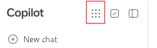

# Installation user-driven

Dans cet exercice, vous allez réaliser les tâches nécessaires pour comprendre l'installation de la suite Office par les utilisateurs. Cette installation *user-driven* est un processus à deux étapes : 

- Configurer le compte utilisateur de telle sorte qu'un utilisateur éligible puisse télécharger les fichiers et réaliser l'installation
- Réaliser l'installation de la suite Office.  

Dans les deux premières tâches de cet exercice, vous allez vérifier en quoi les conditions suivantes affectent la possibilité pour un utilisateur de télécharger la suite Microsoft 365 Apps for enterprise :  

- L'utilisateur n'a pas de licence pour la suite Office (ce que vous vérifierez en tâche 1). 
- Un administrateur désactive le paramètre global permettant aux utilisateurs le téléchargement des applications pour tous les utilisateurs (testé en tâche 2).  

## Tâche 1 – Vérifier l'impact des licences sur l'installation
Dans cette tâche, [PrenomAdmin] va tester si un utilisateur qui ne s'est pas vu affecté de licence peut télécharger Microsoft 365 Apps. Pour ce test, vous pouvez utiliser n'importe quel utilisateur préexistant de la liste **Active Users** dans le portail Microsoft 365 admin center. Ces utilisateurs n'ont pas de compte *on-premises* dans le domaine ADDS.  
Sans compte *on-premises*, vous ne pouvez vous connecter à une VM Cliente. C'est pourquoi vous devez d'abord utiliser un compte ADDS pour vous connecter. Pour ce test, vous utiliserez le compte de **Laura Atkins**. Vous allez créer un compte pour Laura, mais sans lui affecter de licence.  
Vous utiliserez ensuite la VM **LON-CL2** pour installer Microsoft 365 Apps.

1. Basculez donc vers **LON-CL2** et connectez-vous en `Admin` avec le mot de passe `Pa55w.rd`.
1. Vous allez commencer par tester si un utilisateur sans licence Office 365 peut ou non installer Microsoft 365 Apps. Vous avez créé un compte pour Laura dans [l'atelier 2, exercice 1](../a2e1/), mais ne lui avez pas affecté de licence.
1. Dans LON-CL2, cliquez sur l'icône **Microsoft Edge** sur la barre des tâches.
1. Maximisez votre navigateur Internet puis rendez-vous sur la page d'accueil **Copilot** en utilisant l'adresse suivante : `https://m365.cloud.microsoft`

	> Si n'importe quel compte est automatiquement connecté, déconnectez-le nom d'utilisateur (en bas à gauche dans le menu) et en sélectionnant **Sign out**, retapez ensuite `https://m365.cloud.microsoft` dans la barre d'adresse.

1. Cliquez sur **Sign in**.
1. Dans la fenêtre **Sign in**, tapez `Laura@[onmicrosoftDomain].onmicrosoft.com` avant de cliquer sur **Next**.
1. Dans le popup **Enter password**, saisissez `[defaultPass]` et cliquez sur **Sign in**.
1. Dans la boite de dialogue **Update your password**, entrez `[defaultPass]` dans le champ **Current password**, puis entrez `[userPass]` dans les champs **New password** et **Confirm password**. Cliquez sur **Sign in**.
1. Si une fenêtre **Stay signed in?** apparait, cochez la case **Don't show this again** et cliquez sur **Yes.**
1. Si une fenêtre **All your work in one place** apparait, vous pouvez la fermer. 
1. Dans la page d'accueil **Microsoft Copilot**, cliquez sur l'icone **Apps and more**.

1.  Cliquez ensuite sur **More apps**.
1. Sur la page **Apps**, cliquez sur le bouton **Install apps** en haut à droite et sélectionnez **Microsoft 365 apps**.
1. La fenêtre **My account** de Laura s'affiche.
1. Cliquez sur le bouton **View apps & devices**.
1. Vous ne devriez rien y trouver d'installable... 
1. Vous venez de vérifier qu'un utilisateur ne peut télécharger Microsoft 365 Apps for enterprise s'il ne s'est pas vu affecter de licence idoine. Fermez la page **My account** de Laura, mais laissez votre navigateur Internet ouvert pour réaliser la tâche suivante.

## Tâche 2 – Paramètre de téléchargement global
[PrenomAdmin] va désormais tester si les utilisateurs avec licence peuvent être empêchés de télécharger Microsoft 365 Apps si un administrateur comme elle désactive le paramètre global contrôlant ce téléchargement.

1. Basculez vers **LON-DC1**, ou vous devriez encore être connecté avec le compte **Administrator**. Vous devriez également avoir votre navigateur Internet ouvert, et y être connecté avec le compte de Dominique Skyetson avec un onglet ouvert sur le portail **Microsoft 365 admin center**.
1. dans l'onglet de votre navigateur qui affiche le portail **Microsoft 365 admin center**, si nécessaire, cliquez sur **...Show all** dans le menu de navigation afin de pouvoir ouvrir le groupe d'options **Settings**, et sélectionner **Org Settings**.
1. Sur la page **Org settings**, l'onglet **Services** est affiché par défaut. Défilez la liste des services afin de pouvoir cliquer sur **Microsoft 365 installation options**.
1. Dans le panneau **Microsoft 365 installation options** qui s'affiche, cliquez sur l'onglet **Installation** puis, dans la section **Apps for Windows and mobile devices**, décochez la case **Office (includes Skype for Business)**.
1. Cliquez sur **Save**.

	> Laissez le panneau **Microsoft 365 installation options** ouvert car vous allez y revenir dans la tâche suivante.

1. Vous allez utiliser le compte de **Alan Yoo**, qui a aussi été créé lors de [l'atelier 2,exercice1](a2e1.md)(../a2e1/); cependant, contrairement à Laura Atkins, vous aviez affecté une licence [365Licence] à Alan.
1. Basculez vers **LON-CL2**.
1. Sur LON-CL2, vous devez d'abord vous déconnecter du compte de Laura, cliquez donc sur son nom (en bas à gauche) pour cliquer sur **Sign out**.
1. Dans le popup **Pick an account**, cliquez sur le compte de Laura.

	> Suite à une déconnexion, il est très fortement conseillé de fermer tous les onglets de votre navigateur sauf celui qui s'appelle **Login**.

1. Retournez, si nécessaire, sur la page d'accueil **Copilot** en utilisant l'adresse suivante : `https://m365.cloud.microsoft`
1. Cliquez sur **Sign in**.
1. Dans la fenêtre **Pick and account**, cliquez sur **Use another account**.
1. Dans la fenêtre **Sign in**, tapez `alan@[onmicrosoftDomain].onmicrosoft.com` avant de cliquer sur **Next**.
1. Dans le popup **Enter password**, saisissez `[defaultPass]` et cliquez sur **Sign in**.
1. Dans la boite de dialogue **Update your password**, entrez `[defaultPass]` dans le champ **Current password**, puis entrez `[userPass]` dans les champs **New password** et **Confirm password**. Cliquez sur **Sign in**.
1. Si une fenêtre **Stay signed in?** apparait, cochez la case **Don't show this again** et cliquez sur **Yes.**
1. Si une fenêtre **All your work in one place** apparait, vous pouvez la fermer. 
1. Dans la page d'accueil **Microsoft Copilot**, cliquez sur l'icone **Apps and more**.

1.  Cliquez ensuite sur **More apps**.
1. Sur la page **Apps**, cliquez sur le bouton **Install apps** en haut à droite et sélectionnez **Microsoft 365 apps**.
1. La fenêtre **My account** de Alans'affiche.
1. Cliquez sur le bouton **View apps & devices**.
1. Dans la section **Office**, vous ne devriez pas pouvoir installer Office...  

	> Vous venez de vérifier qu'un utilisateur licencié ne peut télécharger Microsoft 365 Apps for enterprise si le paramètre global l'en empêche.

1. [PrenomAdmin] souhaite désormais réactiver le paramètre d'installation global pour que Alan puisse réaliser l'installation de Microsoft 365 Apps for enterprise.  
1. Pour ce faire, basculez de nouveau sur **LON-DC1**. La fenêtre **Microsoft 365 installation options** devrait toujours être ouverte suite à la tâche précédente.  
1. Cliquez sur l'onglet **Installation** si nécessaire et dans la section **Apps for Windows and mobile devices**, cochez la case **Office (includes Skype for Business)** pour réactiver cette fonctionnalité.
1. Cliquez sur **Save**.
1. Une fois vos modifications sauvegardées, cliquez sur le **X** de fermeture en haut à droite du panneau **Microsoft 365 installation options** pour le fermer. 
1. Pour vérifier comment ce changement de paramètre affecte le compte d'Alan dans sa possibilité de télécharger Microsoft 365 Apps, basculez de nouveau sur **LON-CL2**.
1. Sur LON-CL2, le navigateur Internet devrait être resté ouvert sur la page du compte de Alan contenant la section **Office apps and devices**.  
1. Cliquez sur l'icône **Refresh** du navigateur pour recharger complètement la page.
1. Dans la section **Office apps & devices**, un bouton **Install Office** est apparu !

    > Il sera fort probablement nécessaire d'attendre quelques instants et de recharger de nouveau la page...  
    > **l'installation libre-service de Microsoft 365 Apps dépend de services en ligne Microsoft dont la disponibilité peut varier. Si cette étape ne fonctionne pas lors de la réalisation de l'atelier, passez à la suite des exercices et utilisez les notes en base de cet exercice pour vous rappeler de retenter plus tard.**

## Tâche 3 – Installation *user-driven*
Dans la tâche précédente, vous vous êtes connecté avec le compte de Alan Yoo et avez vérifié qu'un utilisateur correctement licencié peut télécharger Microsoft 365 Apps for enterprise. Dans cette tâche, vous allez poursuivre vos tests en procédant à l'installation de la suite office à l'aide du compte de Alan Yoo.  

1. Vous devriez encore être connecté à LON-CL2, avec votre navigateur Internet ouvert sur la page **My Account** de Alan Yoo. 
1. Dans la section **Office apps & devices**, vous avez constaté qu'un bouton **Install Office** est apparu.  

	> En cliquant sur ce bouton  **Install Office** c'est la version anglaise 64 bit de Microsoft 365 Apps qui sera installée. Cependant, si vous souhaitez installer une autre version et/ou une autre langue, il vous faut cliquer sur le bouton **View apps & devices**.  

1. Cliquez sur le bouton  **View Apps &amp; devices** et modifiez le champ **Version** à **32-bit** avant de cliquer sur le bouton orange **Install Office**.
1.  Dans la barre de notification qui apparait en haut à droite de votre navigateur, cliquez sur le lien **Open file** sous le fichier **OfficeSetup.exe** une fois ce dernier téléchargé.
1. Si une boite de dialogue **Do you want to allow this app to make changes to your device?** apparait, cliquez sur **Yes**.
1. L'installation va prendre quelques minutes à se terminer. Une fois l'installation réalisée, cliquez sur le bouton **Close** dans la fenêtre **You're all set!**.
1. Pour vérifier l'installation de Microsoft 365 Apps for enterprise par Alan Yoo, cliquez sur le bouton **Démarrer** en bas à gauche de la barre des tâches. La section **Recently added** (en haut du menu **Démarrer**) affiche Microsoft 365 Apps for enterprise qui vient juste d'être installée. Cela pourra inclure Word, PowerPoint, OneNote, Outlook, Publisher, Access, Teams et Excel.
1. Dans le menu **Démarrer**, cliquez sur **Word**.
1. Dans la fenêtre **Hello Alan, welcome to Word**, cliquez sur **Continue**.
1. Dans la fenêtre **Sign in**, saisissez l'adresse de Alan : `alan@[onmicrosoftDomain].onmicrosoft.com` avant de cliquer sur **Next**.
1. Dans le popup **Enter password**, tapez `[userPass]` et cliquez sur **Sign in.**
1. Cliquez sur le bouton **No, this app only** dans la fenêtre **Sign in to all apps and websites on this device?**

1. Sur la fenêtre **Stay signed in to all your apps**, cliquez sur le lien **No, sign in to this app only**.
1. Sur la fenêtre **Accept the license agreement**, cliquez sur le bouton **Accept**.
1. Dans la fenêtre **Your privacy matters**, cliquez sur **Close**.
1. Vérifiez que Word fonctionne correctement en créant un nouveau document vierge (**Blank document**) et `en tapant un peu de texte par exemple` avant de le sauvegarder dans le dossier **Documents**.
1. Fermez Word.