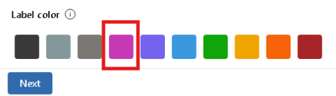

# Création de labels de sensibilité

Ib Cegos Workshop a désormais une bonne vision de Microsoft 365 grâce à son projet pilote. L'organisme a gagné plusieurs contrats gouvernementaux, l'amenant à travailler sur de nombreux produits sensibles et classifiés.  
Dans son rôle d'administratrice de ICW, [PrenomNomAdmin] s'est vu demandé par le CTO d'étudier une solution pour protéger et chiffrer les communications concernant ces contrats sensibles.  
Il lui a également été demandé que tous les documents du "**Projet Renouvellement**" soient automatiquement chiffrés. Il s'agit du nom de code d'un projet top-secret, et il est impératif qu'aucune mention de ce projet ne fuite en dehors du contexte d'ib Cegos Workshop.  
Dans cet atelier, vous allez voir comment mettre en œuvre la réponse à la demande du CTO en utilisant les labels d'informations sensibles dans le centre d'administration *Purview* et avec des commandes *Windows Powershell*.

> Les labels d'informations sensibles et leurs stratégies peuvent prendre jusqu'à 24h pour se propager dans l'intégralité de l'environnement 365. Malheureusement, comme votre stage touche à sa fin, vous ne pourrez peut-être pas vérifier leur application dans votre tenant de test. Ceci étant acté, cet exercice va tout de même vous permettre de découvrir les interfaces de mise en œuvre desdits labels et des stratégies correspondantes.

## Tâche 1 - Créer une équipe *Teams* de test
Dans votre rôle d'administratrice, en tant que [PrenomNomAdmin], vous allez créer une nouvelle équipe *Teams*, nommée **Groupe PRN** (pour groupe *Projet ReNouvellement*) qui sera utilisée pour l'applications des labels de données sensibles par la suite.

1. Basculez vers la machine virtuelle **LON-CL1**, sur laquelle vous devriez être resté connecté avec le compte **adatum\Administrator** avec le mot de passe **Pa55w.rd**.
1. A l'issue de l'atelier précédent, votre navigateur Internet devrait être resté ouvert, avec un onglet contenant le portail **Microsoft 365 admin center**, connecté avec le compte de [PrenomNomAdmin].  

	> Si besoin, utilisez l'adresse `https://admin.cloud.microsoft` pour ouvrir le portail d'administration si vous l'aviez fermé.

1. Dans le menu de navigation du portail **Microsoft 365 admin center**, cliquez sur **Active teams & groups** dans le groupe d'options **Teams & groups**.
1. Sur la page **Active teams & groups**, cliquez sur le bouton **+ Add a team** sur la barre d'outils de l'onglet **Teams & Microsoft 365 groups**.
1. Sur la page **Set up the basics**, saisissez `Groupe PRN` dans le champ **Name of team** et `Groupe utilisé pour les tests des labels de sensibilité.` dans le champ **Describe this team**.
1. Cliquez sur **Next**.
1. Sur la page **Add owners**, entrez `[PrenomAdmin]` dans le champ **Owners** et cliquez sur le compte de **[PrenomNomAdmin]** lorsqu'il s'affiche.
1. Toujours sur la page **Add owners**, saisissez `Elvis` et cliquez sur le compte de **Elvis Cress** qui s'affiche.
1. Cliquez sur **Next**.
1. Sur la page **Add members**, entrez `Beth` dans le champ **Members** et cliquez sur le compte de **Beth Burke** lorsqu'il s'affiche.
1. Procédez de même pour ajouter les comptes de `Alan` (Alan Yoo) et `Joni` (Joni Sherman).
1. Cliquez sur le bouton **Next**.
1. Sur la page **Edit settings**, saisissez `groupePRN` dans le champ **Team email address**.  
1. Toujours sur la page **Edit Settings**, dans le champ **Privacy**, sélectionnez **Private - People can only join if they're added by an owner\[...].**.
1. Cliquez sur le bouton **Next**.
1. Sur la page **Review and finish adding team**, cliquez sur le bouton **Add Team**.
1. Sur la page **New team created**, notez le message indiquant qu'il peut s'écouler 5 minutes avant que la nouvelle équipe ne s'affiche. Cliquez sur **Close**.
1. Sur la page **Active teams and groups**, cliquez sur le bouton **Refresh** dans la barre de menu au-dessus de la liste des groupes. Si nécessaire, attendez quelques instants et répétez l'opération jusqu'à ce qu'apparaisse la nouvelle équipe.

## Tâche 2 - Création de labels dans le portail *Purview*
[PrenomAdmin] a décidé de tester la création de labels de données sensibles en utilisant le portail *Purview* et *Windows Powershell*. Dans cette tâche, vous allez d'abord utiliser le portail *Purview* pour créer un premier label.

1. Dans le menu du portail **Microsoft 365 admin center**, cliquez sur **Microsoft Purview** sous la section **Admin centers**.
1. Cliquez sur **Get started**.
1. Dans le menu de navigation du portail **Microsoft Purview**, cliquez sur **Solutions -> Information Protection**.
1. Dans le menu **Information protection**, cliquez sur le choix **Sensitivity labels**.
1. Sur la page **Labels**, cliquez sur **+ Create -> label** dans la barre de menu au-dessus de la liste des labels.
1. Sur la page **Provide basic details for this label**, saisissez `ICW-Classifié` dans les champs **Name** et **Display name**
1. Saisissez `Pour utilisation officielle uniquement` dans les champs **Description for Users** et **Description for admins**
1. Choisissez la couleur *Berry* pour ce label en cliquant sur le carré la contenant.

1. Cliquez sur le bouton **Next**.
1. Sur la page **Define the scope for this label**, cliquez sur **Next**.
1. Sur la page **Choose protection settings for the types of items you selected**, cochez la case devant **Apply content marking** et cliquez sur **Next**.
1. Sur la page **Content marking**, cliquez sur le contrôle de bascule **Content marking** pour le faire passer à *ON**. De nouvelles options s'affichent que vous allez compléter dans les étapes suivantes.
1. Cochez la case **Add a watermark** et cliquez sur le bouton **Customize text**.
1. Dans le panneau **Customize watermark text**, saisissez les informations suivantes avant de cliquer sur le bouton **Save** :
	- **Watermark text** : `ib Cegos Workshop - CLASSIFIE`
	- **Font size** : `48`
	- **Font color** : **Red**
	- **Text layout** : **Diagonal**
1. Cochez la case **Add a header** et cliquez sur le bouton **Customize text**.
1. Dans le panneau **Customize header text**, saisissez les informations suivantes avant de cliquer sur le bouton **Save** :
	- **Header text** : `UNIQUEMENT POUR UTILISATION OFFICIELLE`
	- **Font size** : `12`
	- **Font color** : **Blue**
	- **Align text** : **Left**
1. Cliquez sur le bouton **Customize text** sous la case à cocher **Add a footer** (cochez-là si elle ne l'est pas par défaut).
1. Dans le panneau **Customize footer text**, saisissez les informations suivantes avant de cliquer sur le bouton **Save** :
	- **Footer text** : `ib Cegos Workshop - CLASSIFIE`
	- **Font size** : `12`
	- **Font color** : **Green**
	- **Align text**: **Left**
1. Sur la page **Content marking**, cliquez sur le bouton **Next**.
1. Sur la page **Auto-labeling for files and emails**, assurez-vous que l'option **Auto-labeling for files and emails** reste désactivée et cliquez sur **Next**.
1. Sur la page **Define protection settings for groups and sites**, cliquez sur **Next**. 
1. Sur la page **Review your settings and finish**, révisez votre saisie et, si nécessaire, cliquez sur le lien **Edit** pour les modifier ; sinon, cliquez sur le bouton **Create label** en bas de page.
1. Sur la page **Your sensitivity label was created**, sélectionnez **Don't create a policy yet**, vous réaliserez la publication des labels dans le prochain exercice.
1. Cliquez sur Done.

## Tâche 3 - Création de labels avec *Windows PowerShell*
Après avoir testé la création de labels de données sensibles en utilisant le portail *Purview*, [PrenomAdmin] souhaite tester la création de labels avec *Windows Powershell*. 

1. Si vous aviez minimisé la fenêtre **Administrator: Windows Powershell** dans la barre des tâches, cliquez sur son icône pour la maximiser. Sinon, tapez `Windows Powershell` dans le champ de recherche à droite du bouton **Démarrer** sur la barre des tâches. A droite du menu **Démarrer**, cliquez sur **Run as administrator** sous l'application.
1. Dans la commande de **Administrator: Windows PowerShell **, utilisez la commande suivante :  `Install-Module -Name ExchangeOnlineManagement -Force`
1. Dans l'invite Powershell, utilisez la commande suivante pour vous connecter à l'environnement *Purview* : (Si la commande pose problème en **Powershell ISE**, utilisez une simple invite **Powershell**) :  `Connect-IPPSSession -Credential dom@[onmicrosoftDomain].onmicrosoft.com`

    > En cas d'erreur dans la commande de connexion, essayez de relancer l'invite **Windows Powershell** après avoir installé le module.

1. Sur la page **Windows PowerShell credential request**, saisissez `[userPass]` dans le champ **Password** avant de cliquer sur **Sign in**.
1. Dans l'invite Powershell, utilisez la commande suivante pour créer un nouveau label de données sensibles nommé *Adatum-Secret* :  
    `New-Label -Name ICW-Secret -DisplayName ICW-Secret -Tooltip 'UNIQUEMENT pour les contrats gouvernementaux' -AdvancedSettings @{Color="Red"} -Comment 'Pour utilisation UNIQUEMENT avec les contrats gouvernementaux' -ApplyContentMarkingFooterEnabled $true -ApplyContentMarkingFooterText 'ib Cegos Workshop - SECRET' -ApplyContentMarkingFooterFontSize 12 -ApplyContentMarkingFooterFontColor '#008000' -ApplyContentMarkingFooterAlignment left -ApplyContentMarkingHeaderEnabled $true -ApplyContentMarkingHeaderText 'TOP SECRET' -ApplyContentMarkingHeaderAlignment left -ApplyContentMarkingHeaderFontColor '#0000FF' -ApplyContentMarkingHeaderFontSize 12 -ApplyWaterMarkingEnabled $true -ApplyWaterMarkingText 'ib Cegos Workshop - SECRET' -ApplyWaterMarkingFontColor '#FF0000' -ApplyWaterMarkingFontSize 48 -ApplyWaterMarkingLayout Diagonal`

1. Basculez vers votre navigateur Internet et affichez l'onglet du portail **Microsoft Purview**. Vous devriez être resté sur la page **Labels**.
1. Dans la liste des labels, le label **Adatum-Classified** que vous avez créé dans le portail est affiché. Cliquez sur le bouton **Refresh** dans la barre de menu au-dessus de la liste.
1. Vous devriez désormais trouver dans la liste des labels le label **ICW-Secret** que vous venez de créer en PowerShell en plus du label **ICW-Classifié**.