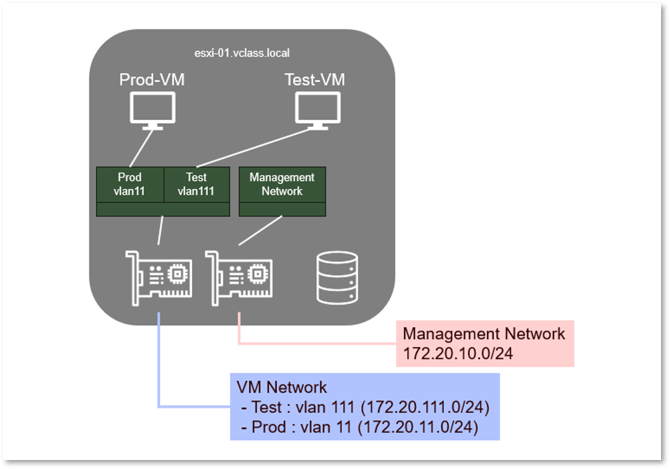
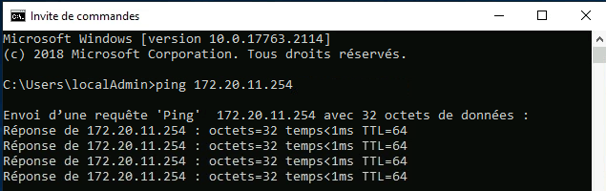
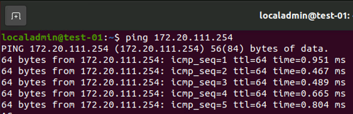
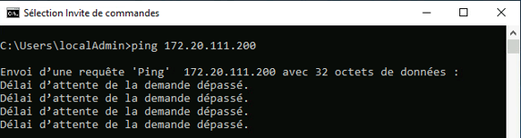

# Vérification de l’existant

## Objectif :

Dans cet exercice, vous allez vérifier le bon fonctionnement des machines virtuelles à migrer vers Proxmox



### Étape 1 - Connectez-vous au Host-Client de votre serveur ESXi :

1. Ouvrez **Firefox** (Il y a un raccourci dans la barre des tâches de votre machine « Student »)
2. Dans la barre personnelle de Firefox, ouvrez le dossier **Scénario** et choisissez **ESXi-01 (Host-Client)**
3. Identifiez-vous en tant que **root**    

### Étape 2 - Vérifiez la connectivité réseau de vos 2 VMs vers leur passerelle respective (ping) en vous connectant en console sur chacune de ses VMs :

1. Prod-01 :  
    - Utilisateur : **localadmin**
    - Adresse de passerelle : **172.20.11.254**
    

2. Test-01 :  
    - Utilisateur : **localadmin**
    - Adresse de passerelle : **172.20.111.254**
    

### Étape 3 - Vérifier la non-connectivité entre ces deux VMs :

Pour récupérer l'adresse IP :    
    - Windows : ```ipconfig```    
    - Ubuntu : ```ip a```    
    Notez au passage le nom de l’interface réseau : ens160    
    Ce nom d’interface risque de changer après la migration de la VM. Il faudra certainement adapter la configuration réseau de la machine
    