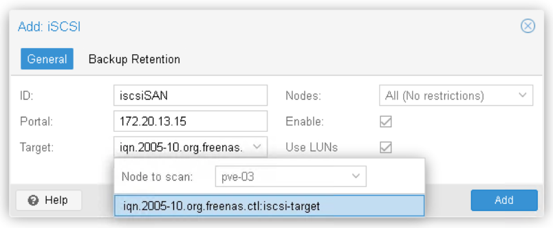

# Découverte et connexion à une cible iSCSI

## Objectif

Dans cet exercice, vous allez :

* Découvrir une cible iSCSI mise à disposition sur le réseau.
* Connecter le cluster Proxmox à cette cible.
* Vérifier la présence des LUN exposés par le serveur de stockage.
* Vérifier que les différents nœuds du cluster accèdent au même stockage partagé.

## Étape 1 - Création du stockage iSCSI

1. Connectez-vous à l’interface d’administration du **Cluster 3 nœuds**. Firefox -> Scénario 3 -> PVE-03 (ou 04 ou 05)
2. Sélectionnez **Datacenter** -> **Storage** -> **Add** -> **iSCSI**
3. Dans la fenêtre "**Add iSCSI**", renseignez les paramètres suivants :
    | Paramètre | Valeur |
    | --- | --- |
    | ID | iscsiSAN |
    | Portal | 172.20.13.15 |
    | Target| Choisir iqn.2005-10.org.freenas.ctl:iscsi-target |
    | Nodes | All |
    | Enable | Oui |
    | Use LUNs | Oui |
4. Validez la création du stockage en cliquant sur **Add**
    

## Étape 2 - Vérification de la connexion

1. Dans l’inventaire, sélectionnez le stockage **iscsiSAN**.
2. Consultez l'onglet **Status**.  
    Vous constatez que 3 LUNs sont maintenant visibles : LUN1, LUN2 et LUN3
3. Ouvrez une session **Shell** sur un **autre noeud** de votre cluster et exécutez la commande :```iscsiadm -m session```  
    Vous constatez qu'une session a bien été établie vers la cible iqn.2005-10.org.freenas.ctl:iscsi-target
5. Exécutez ensuite ```lsblk```  
    Vous pouvez maintenant identifier les nouveaux périphériques correspondant aux LUNs exposés par le serveur de stockage (sdb, sdc et sdd)
7. Vous pouvez fermer la fenêtre de la session Shell.
8. Dans l'interface d'administration, dans l'inventaire, vérifiez que **iscsiSAN** est visible sous chaque noeud de votre cluster.  
    En effet, le stockage iSCSI est un stockage partagé accessible simultanément par tous les noeuds du cluster