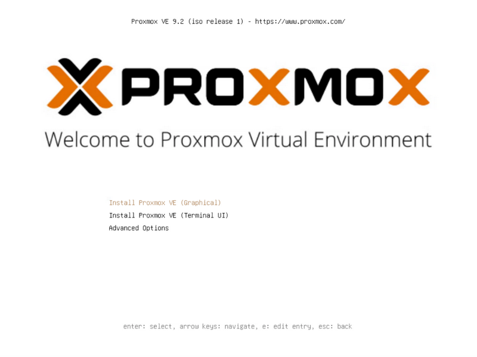
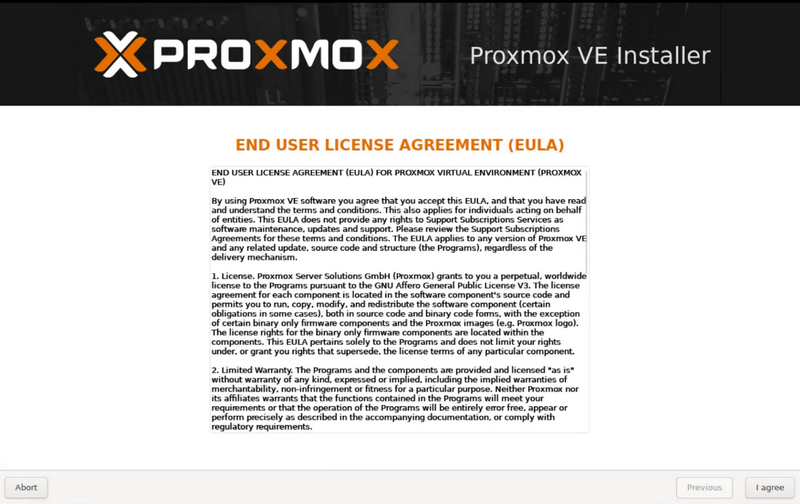
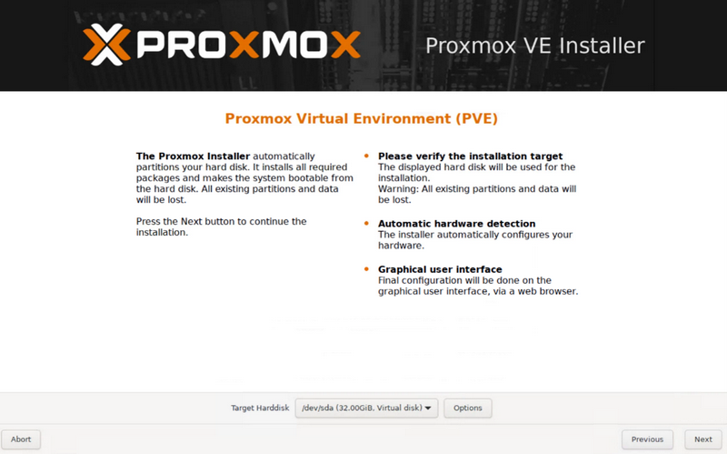
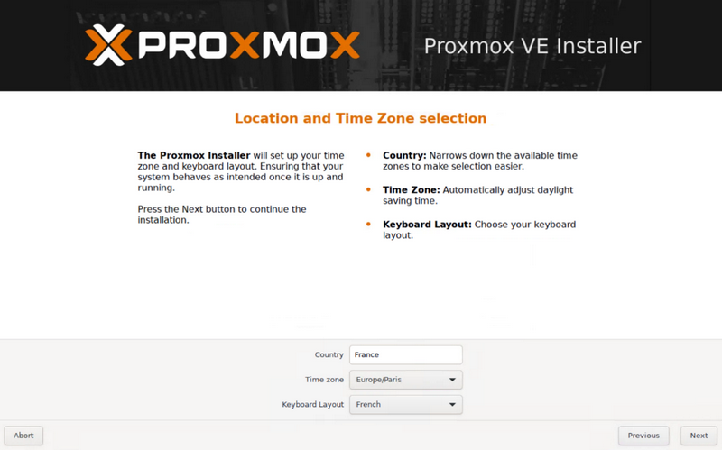
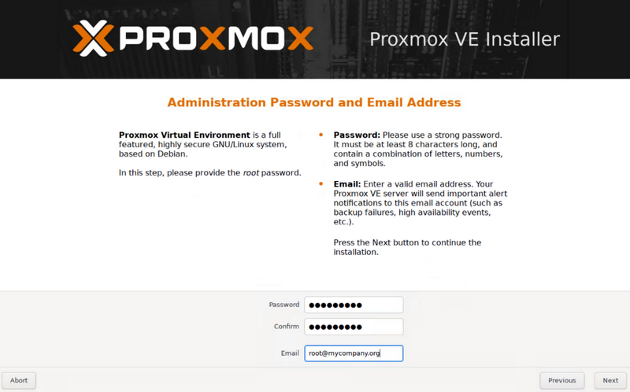
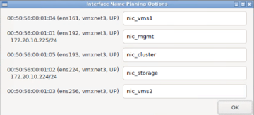
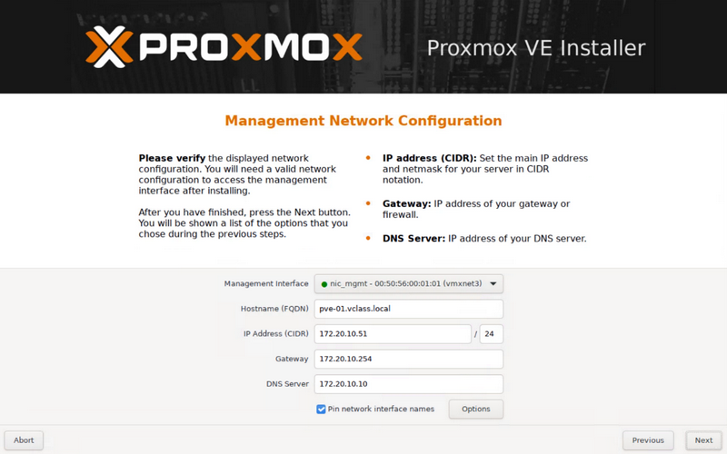
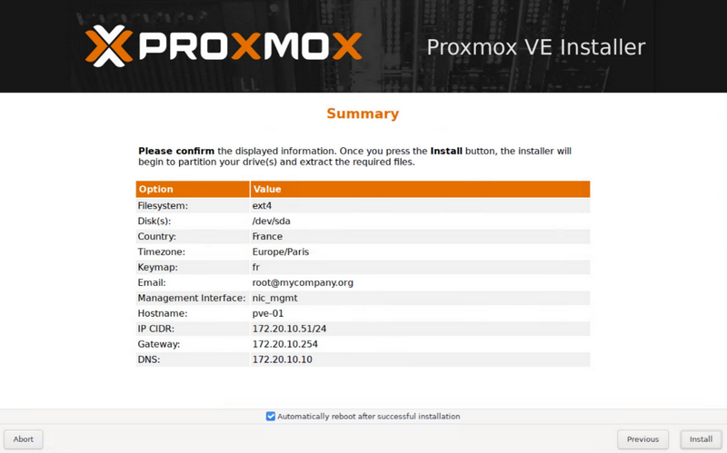
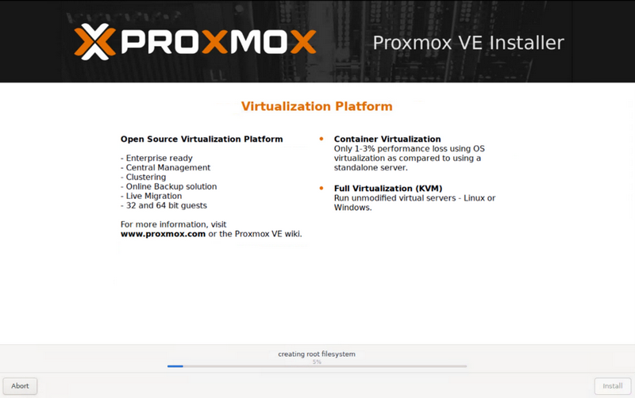
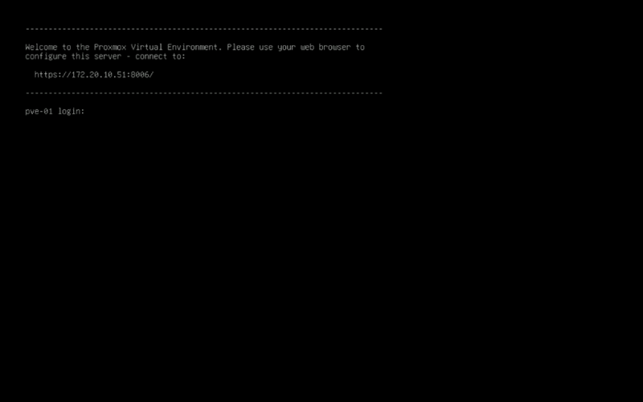

# Installation de Proxmox VE

## Objectif :

Dans cet exercice, vous allez installer votre premier serveur Proxmox VE

1. Dans la barre personnelle de Firefox, ouvrez le dossier **Scénario 1** et sélectionnez **PVE-01 (VM Console)**  
    Si vous recevez un avertissement de sécurité, **Acceptez le risque…**

2. Dans la fenêtre de Login "VMware vSphere", authentifiez-vous avec vos **identifiants Guacamole** (en ajoutant **mars\** avant votre nom d’utilisateur

3. Dans la vue **VMs & Templates**, naviguez jusqu’à la VM **pve-01** et ouvrez une console web sur cette VM

4. Cette VM est votre premier serveur Proxmox VE. Il vient de démarrer sur l’image ISO d’installation et n’attend plus que vous pour être installé.  
    Choisissez la méthode d’installation graphique en appuyant sur la touche ‘Entrée’
    -> **Install Proxmox VE (Graphical)**
    

5. Acceptez le contrat de licence (Après l’avoir lu attentivement bien entendu 😊)    
    -> **I Agree**
    

6. Choisissez le disque sur lequel vous souhaitez installer Proxmox VE    
    C’est celui de 32 Go
    
    -> **Next**

7. Choisissez le pays, le fuseau horaire, ainsi que la disposition du clavier    
    -> **France**    
    -> **Europe/Paris**    
    -> **French**    
    
    -> **Next**

8. Renseignez le mot de passe qui sera attribué à l’utilisateur « root » ainsi que son adresse email
    -> **Proxmox1 !**   
    -> **Proxmox1 !**   
    -> **root@mycompany.org**   
    
    -> **Next**    

9. Renseignez les paramètres réseau    
    - A côté de "Pin network interface names" (qui doit rester coché), cliquez sur **Options**    
    - Renseignez le tableau de mappage comme suit :    

      | Nom de l’interface | Nom logique | Rôle |
      | --- | --- | --- |
      | ens161 | nic_vms1 | Réseaux des VMs (Trunk) |
      | ens192 | nic_mgmt | Réseau d’administration |
      | ens193 | nic_cluster | Réseau corosync |
      | ens224 | nic_storage | Réseau de stockage |
      | ens256 | nic_vms2 | Réseau des VMs (Trunk) |

      A l’écran, ça devrait donner ça :
      
    - Cliquez sur **OK**
    - Choisissez l’interface **nic_mgmt** pour la "Management Interface"
    - Hostname : **pve-01.vclass.local**
    - IP Addresse : **172.20.10.51 / 24**
    - Gateway : **172.20.10.254**
    - DNS Server : **172.20.10.10**
    
    -> **Next**    

10. Vérifiez les informations    
        
    -> **Install**    

11. Attendez la fin de l’installation et le redémarrage du serveur
    

12. Le serveur est installé
    
    Vous pouvez fermer l’onglet « pve-01 » dans Firefox