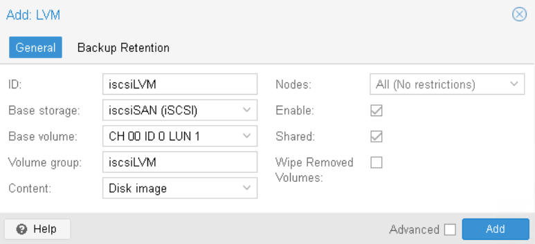

# Exploitation du stockage iSCSI avec LVM

## Objectif

Dans cet exercice, vous allez :

* Créer un stockage LVM partagé reposant sur un LUN iSCSI.
* Déplacer une machine virtuelle vers ce stockage.
* Vérifier le fonctionnement du stockage partagé.
* Identifier les limitations du iSCSI/LVM.

## Étape 1 - Création du stockage LVM

1. Connectez-vous à l’interface d’administration du **Cluster 3 nœuds**. Firefox -> Scénario 3 -> PVE-03 (ou 04 ou 05)
2. Sélectionnez **Datacenter** -> **Storage** -> **Add** -> **LVM**
3. Dans la fenêtre "**Add LVM**", renseignez les paramètres suivants :  
    | Paramètre | Valeur |
    | --- | --- |
    | ID | iscsiLVM |
    | Base Storage | iscsiSAN |
    | LUN | LUN 1 |
    | Volume Group | iscsiLVM |
    | Content | Disk image |
    | Shared | Oui |
4. Validez la création du stockage en cliquant sur **Add**  
    

## Étape 2 - Vérification du stockage

1. Dans l’inventaire, vérifiez que **iscsiLVM** apparait également sur vos 2 autres noeuds (pve-04 et pve-05)
2. Si le stockage apparait avec un '?', il faut forcer un rescan depuis une session Shell sur chaque noeud :  
    ```
    pvscan --cache
    ```

## Étape 3 - Déplacement de la machine virtuelle

1. Sélectionnez la machine virtuelle **Test-01**.  
2. Ouvrez l'onglet **Hardware**.
3. Sélectionnez le disque principal de la machine virtuelle.
4. Cliquez sur **Disk Action** puis **Move Storage**.  
    | Paramètre | Valeur |
    | --- | --- |
    | ID | iscsiLVM |
    | Target Storage | iscsiLVM |
    | Delete source | Oui |
5. Cliquez sur **Move Storage** et attendez la fin de l'opération.  
    Le disque virtuel de Test-01 est maintenant hébergé sur notre stockage iSCSI