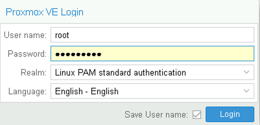
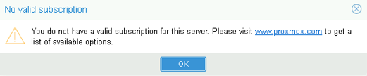
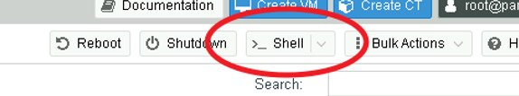

# Configuration et mise à jour de Proxmox VE

## Objectifs :

Dans cet exercice, vous allez :

- Objectif 1 - Configurer le client NTP de votre serveur Proxmox VE
- Objectif 2 - Mettre à jour votre serveur Proxmox VE

### Étape préalable - Connexion au serveur

1. Dans la barre personnelle de Firefox, ouvrez le dossier **Scénario 1** et sélectionnez **PVE-01 (Admin Console)** (ou saisissez l’URL https://pve-01.vclass.local:8006)    
    **Acceptez le risque…**
2. Identifiez-vous à l’aide des informations d’identification que vous avez fourni lors de l’installation (**root** / **Proxmox1!**) (**Linux PAM standard authentication**)    
    Vous pouvez choisir la langue qui vous convient (Les instructions fournis dans ces Labs utilisant les termes anglais, il est recommandé de choisir la langue **English – English**    
    Vous pouvez sauvegarder le nom de l’utilisateur (ou pas)  
    
3. Un message d’avertissement vous alertera que vous n’avez pas de souscription valide pour ce serveur. Vous devrez cliquer sur **Ok** à chaque fois que ce message apparaîtra. C’est le prix à payer lorsqu’on utilise Proxmox VE gratuitement, sans souscrire au support.
    

## Objectif 1 - Configuration du client NTP

1. Dans la vue **Server View**, sélectionnez votre serveur **pve01**
2. Cliquez sur le bouton **Shell** situé en haut à droite du panneau principal afin d’ouvrir une session Shell dans une nouvelle fenêtre de navigateur
    
    (Vous pouvez redimensionner la fenêtre de votre session Shell si besoin)
3. Une fois dans la session Shell, créez un nouveau fichier de sources NTP avec votre serveur NTP local (1 seule ligne) :
    ```
    echo 'server 172.20.10.254 iburst' > /etc/chrony/sources.d/local-ntp-server.sources
    ```
4. Supprimez la source de temps par défaut :

    - Editez le fichier de configuration NTP :    
      ```
      nano /etc/chrony/chrony.conf
      ```
    - Commentez la ligne commençant par "pool" en ajoutant un **#** en début de ligne
    - Quittez nano : **CTRL-X**
    - Nano vous demande si vous souhaitez sauvegarder les modifications :     
      Répondez **Y** puis **Entrée**

5. Redémarrez le service Chrony :
    ```
    systemctl restart chronyd
    ```
6. Vérifiez que les modifications ont bien été prises en compte :
    ```
    journalctl --since -1h -u chrony
    ```
    Vous devriez remarquer une ligne : « Selected source 172.20.10.254 »    
    Si c’est le cas, vous avez bien modifié la source de synchronisation de l’horloge    
    Pressez la touche **q** pour sortir du journal    
7. Quittez le shell :
    ```
    Exit
    ```
    Fermez la fenêtre de shell

## Objectif 2 - Mise à jour du serveur Proxmox VE  

### Etape 1 - Modification des Repositories  
Dans sa configuration par défaut, Proxmox utilise les Repositories liés à une souscription au support Proxmox. Comme nous n’avons pas de souscription, il est nécessaire de modifier la configuration de Proxmox afin qu’il utilise les Repositories communautaires gratuits.

1. Dans la vue **Server View**, sélectionnez votre serveur **pve01**
2. Dans le menu du serveur, développez la section **Updates** et sélectionnez **Repositories**
3. Dans la fenêtre principale, sous **APT Repositories**, cliquez sur **Add**
4. Choisissez le Repository **No-Subscription**, puis cliquez sur **Add**
5. Désactivez tous les repositories dont l’URL commence par **https://enterprise.proxmox.com/...** en les sélectionnant et en cliquant sur **Disable**

### Etape 2 - Mise à jour du serveur avec l’interface graphique  
Cette étape vise à vous montrer la mise à jour du serveur via l'interface graphique  
Si vous préférez faire ces actions en ligne de commande, suivez plutôt l'étape suivante (Etape 2bis)  

1. Dans le menu du serveur, sélectionnez **Updates**
2. Cliquez sur **Refresh** pour actualiser la liste des mises à jour installables
3. Vous pourrez fermer la fenêtre de tâche une fois le message **TASK OK** affiché
4. Cliquez sur **Upgrade** pour mettre à jour
5. Une fenêtre Shell s’ouvre. Vous devez confirmer en tapant **y** puis Entrée
6. Une fois le process de à jour terminé, vous verrez apparaître le message **Your System is up-to-date**. Il sera indiqué également si votre serveur nécessite un redémarre. Si c’est le cas, vous pouvez simplement taper la commande **reboot** 

### Etape 2bis - Mise à jour du serveur avec le Shell  
Cette étape vise à vous montrer la mise à jour du serveur via le Shell.  
Si vous préférez faire ces actions via l'interface graphique, suivez plutôt l'étape suivante (Etape 2)  

1. Ouvrez une fenêtre Shell sur votre serveur
2. Actualisez la liste des mises à jour installables :  
    ```
    apt update
    ```
3. Installez les mises à jour :
    ```
    apt dist-upgrade
    ```