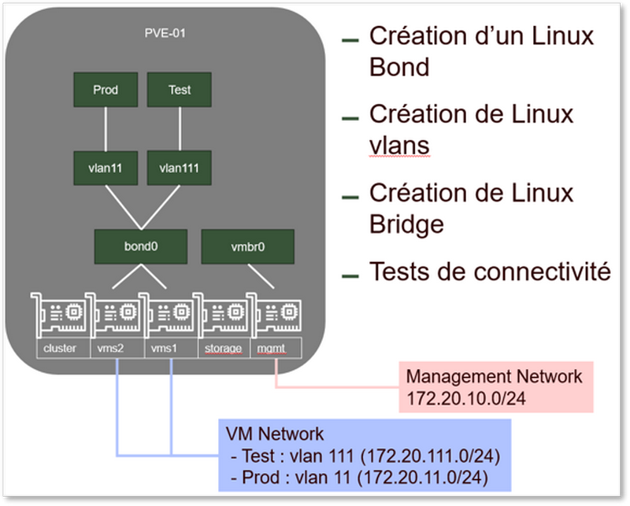
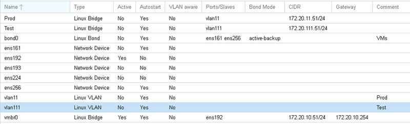
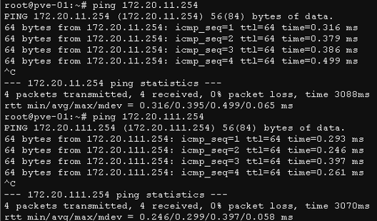

# Configuration du réseau (Bridge)

## Objectifs

Cet exercice va vous permettre configurer le réseau de votre serveur Proxmox afin d'offrir aux VMs qui seront migrées la même connectivité réseau que celle qui leur était fournie sur le serveur ESXi, à savoir :

- Une isolation entre Prod et Test par des VLANs
- Une redondance sur les cartes réseau physiques

Dans cet exercice, vous allez :

- Objectif 1 - Créer un Linux Bond (pour assurer la redondance)
- Objectif 2 - Créer des Linux VLANs (pour l'isolation)
- Objectif 3 - Créer des Bridge (pour la connexion des VMs)



## Objectif 1 - Création d’un Bond pour le réseau de VMs :

Pour le réseau des VMs, nous voulons mettre en place de la redondance. Nous allons donc pour cela créer un **Linux Bond** regroupant les interfaces **nic_vms1** et **nic_vms2**

1. Dans l’interface d’administration de Proxmox, dans le menu du serveur **pve-01**, développez le nœud **System**, puis sélectionner **Network**  
    Vous retrouvez ici :

    - Vos interfaces physiques "nic_*"
    - 1 Bridge "vmbr0" créé pendant l’installation du serveur, sur lequel est configurée l’adresse IP de votre serveur

2. Cliquez sur le bouton **Create**, et choisissez **Linux Bond**
3. Renseignez les champs suivants :

    - Name : ```bond0```
    - Slaves : ```nic_vms1 nic_vms2```
    - Mode : Choisissez ***active-backup***
    - Bond-primary : ```nic_vms1```
    - Comment : ```VMs```

## Objectif 2 - Création des vLans Linux :

1. Cliquez sur le bouton **Create**, et choisissez **Linux VLAN**    
    Renseignez les champs suivants :

    - Name : ```vlan11```
    - Vlan raw device : ```bond0```
    - Comment : ```Prod```

2. Cliquez à nouveau sur le bouton **Create**, et choisissez **Linux VLAN**
3. Renseignez les champs suivants :

    - Name : ```vlan111```
    - Vlan raw device : ```bond0```
    - Comment : ```Test```

## Objectif 3 - Création des Bridges pour les réseaux de VMs :

1. Cliquez sur le bouton **Create**, et choisissez **Linux Bridge**    
    Renseignez les champs suivants :

    - Name : ```Prod```
    - IPv4/CIDR : ```172.20.11.51/24```
    - Bridge ports : ```vlan11```
    - Comment : ```Prod```

2. Cliquez à nouveau sur le bouton **Create**, et choisissez **Linux Bridge**    
3. Renseignez les champs suivants :

    - Name : ```Test```
    - IPv4/CIDR : ```172.20.111.51/24```
    - Bridge ports : ```vlan111```
    - Comment : ```Test```

> Nous avons défini une adresse IP afin de pouvoir tester la connectivité. Nous la supprimerons une fois le test effectué

## Vérification de la configuration réseau :    
Voici à quoi elle devrait ressembler :

Si ce n’est pas le cas, pas de panique !    
Pour le moment, nous n’avons pas encore appliqué la configuration. Vous pouvez encore faire des modifications ou bien, en cas de besoin, cliquer sur le bouton "Revert" pour supprimer toutes les modifications qui n’ont pas encore été appliquées (Attention, il n’y aura pas de confirmation après avoir cliqué sur le bouton "Revert")    
Une fois que vous avez vérifié votre configuration, cliquez sur **Apply Configuration**

1. **Vérification de la connectivité**  
  Afin de vérifier la connectivité, nous allons ouvrir une session shell sur le serveur et tenter de pinguer les passerelles des réseaux de Prod et de Test (172.20.11.254 / 172.20.111.254)
  
2. **Nettoyage**  
  Une fois que vous avez validé la connectivité des 2 réseaux, vous pouvez aller **supprimer les 2 adresses IP** qui ont été définies sur les bridges Prod et Test. C’est un point important, car nous ne souhaitons pas que le serveur Proxmox soit accessible depuis les réseaux de VMs.  
  Si vous êtes consciencieux, vous irez peut-être même **tester à nouveau la connectivité** pour valider qu’il n’y a plus de réponse des passerelles.  
  Et s’il y en a toujours, c’est peut-être que vous avez oublié de cliquer sur "Apply Configuration"

Votre serveur dispose maintenant d’une configuration réseau lui permettant d’héberger vos VMs de Prod et de Test.