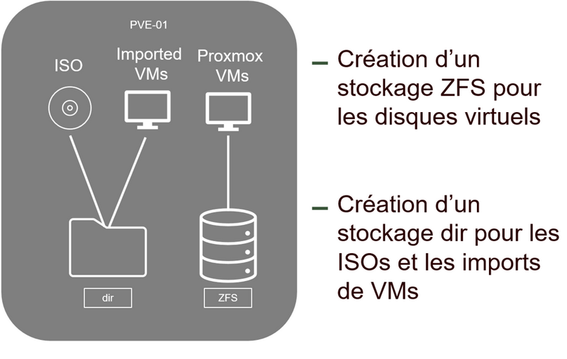
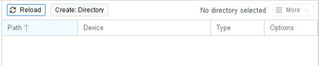
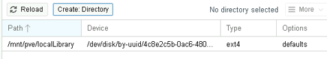

# Configuration du stockage (local)

## Objectifs

Cet exercice va vous permettre de configurer le stockage local de votre serveur Proxmox afin d'héberger : 

- Les imports des VMs vSphere
- Les disques virtuels des VMs Proxmox

Dans cet exercice, vous allez :

- Objectif 1 - Créer un stockage de type 'directory' pour les exports de VMs qui auront été faits depuis le serveur ESXi
- Objectif 2 - Créer un stockage ZFS pour les disques virtuels des VMs Proxmox, une fois qu'elles auront été converties



### Étape préalable - Vérification des disques disponibles

1. Dans l’interface d’administration de Proxmox, dans le menu du serveur **pve-01**, sélectionner **Disks**  
    Vous retrouvez ici les disques physiques accessibles depuis votre serveur :

    - /dev/sda : c’est le disque sur lequel Proxmox a été installé
    - /dev/sdb : Non utilisé
    - /dev/sdc : Non utilisé

> Le bouton "Wipe Disk" permet d’effacer totalement un disque pour le réutiliser dans Proxmox

## Objectif 1 - Création et configuration du stockage de type Directory :

1. Dans le menu du serveur, sous **Disks**, sélectionnez **Directory**
    Vous pouvez constater que la liste est vide. Vous n’avez pas encore de stockage de type Directory
    
2. Cliquez sur le bouton **Create Directory**
3. Dans la fenêtre "Create Directory", renseignez les informations suivantes :

    - Disk : **/dev/sdb**
    - Filesystem : **ext4**
    - Name : ```localLibrary```

    Puis, validez à l’aide du bouton **Create**
    La liste affiche maintenant 1 stockage de type Directory :
    
    > [!IMPORTANT] Dans Proxmox, la **création** du stockage local se fait sur le serveur, mais la **configuration** du stockage se fait sur le Datacenter. Ainsi, lorsque plusieurs serveurs Proxmox disposent des mêmes éléments de stockage, la configuration de ces éléments se fait de façon centralisée

4. Dans l’arborescence, sélectionnez **Datacenter**, puis, dans le menu du Datacenter, sélectionnez **Storage**  
    On retrouve ici tous les stockages de tous les serveurs de ce Datacenter, leur type, ainsi leurs types de contenus autorisés
5. Sélectionnez **localLibray**, puis cliquez sur **Edit**  
    Dans la fenêtre **Edit Directory**, dans le champ **Content**, vous pouvez définir les types de contenus autorisés sur ce stockage.
      - Sélectionnez le type **Import**
      - Désélectionnez tous les autres types à l'exception de **ISO Image**
      - Validez en cliquant sur **Ok**
6. Votre stockage de type Directory est maintenant configuré

## Objectif 2 - Création du stockage de ZFS :

1. Dans l’arborescence, sélectionnez **pve-01**, puis, dans le menu du serveur, sous  **Disks**, séletionnez **ZFS**
2. Cliquez sur le bouton **Create ZFS**
3. Dans la fenêtre **Create ZFS**, renseignez les informations suivantes :

    - Name : ```localVMs```
    - Device : Cochez la case devant **/dev/sdc**

    Puis, validez à l’aide du bouton **Create**

4. Comme vous l’avez fait pour le stockage de type Directory, configurer ce nouveau stockage :

    - Afin qu’il n’accepte que le type **Disk Image**
    - Afin qu’il provisionne dynamiquement l’espace disque (Thin provision)

5. Votre stockage de type ZFS est maintenant configuré