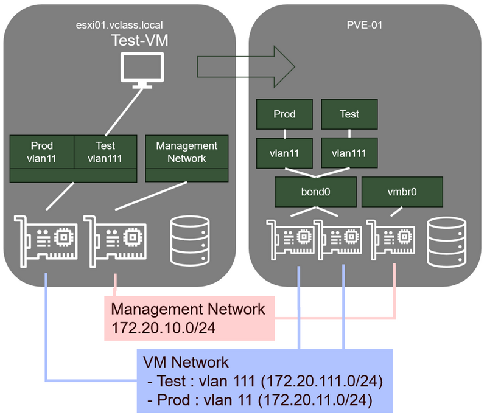

# Migration d'une machine virtuelle Linux en mode déconnecté (Export/Import)



### Étape 1 - Préparation de la VM Test-01:

Connectez-vous au ** Host-Client** de votre serveur ESXi-01, puis, successivement :

1. Connectez-vous en **console** votre VM **Test-01** pour **désinstaller les VMware Tools** :

- Loguez-vous en tant que **localadmin**
- ```sudo apt remove open-vm-tools```

2. Arrêtez proprement Test-01 (Depuis la console de la VM, car les VMware Tools ayant été désinstallés, il n’est plus possible de l’éteindre proprement depuis le Host-Client) :
    ```
    shutdown now
    ```

### Étape 2 - Exportation de Test-01 depuis le Host-Client

1. Clic droit sur la VM -> **Exporter**
2. Cochez toutes les cases
3. Cliquez sur le bouton **Exporter**
    Le téléchargement des fichiers d’export démarre dans Firefox  
    Attendez la fin des téléchargements (5 minutes environ)  
    (Pour info, la taille du vmdk est de 2.9 Go)

### Étape 3 - Copie des fichiers vers le serveur Proxmox

1. Dans la barre des tâches de la machine "Student", lancez **WinSCP**
2. Dans la fenêtre de Login de WinSCP, dans la liste des sites, double-cliquez sur "**root@pve-01.vclass.local**" (Mettez à jour l’empreinte de certificat si nécessaire)  
    WinSCP est maintenant connecté à votre serveur Proxmox VE  
    La fenêtre de gauche représente votre machine locale  
    La fenêtre de droite représente votre serveur Proxmox VE  
3. Dans la fenêtre de gauche, naviguez jusqu’à l’emplacement de vos VMs exportées (**C:\Users\Administrator\Downloads**)
4. Dans la fenêtre de droite, naviguez jusqu’au dossier "import" de votre stockage de type Directory (**/mnt/pve/localLibrary/import**)
5. Sélectionnez dans la fenêtre de gauche tous les fichiers de type : **.ovf** et **.vmdk** et glissez-les jusqu’à la fenêtre de droite
6. Attendez la fin de la copie (2 minutes environ)
7. Fermez WinSCP

### Étape 4 - Importation de la VM dans Proxmox

1. Dans la **console d’administration** de Proxmox VE, dans l’arborescence, sous votre serveur Proxmox, sélectionnez le stockage "**localLibrary**"
2. Dans le panneau principal :

    - Sélectionnez **Import**
    - Sélectionnez **Test-01.ovf**
    - Cliquez sur le bouton **Import**

3. Dans la fenêtre "Import Guest…", vérifiez les informations et corrigez si nécessaire :

    - Default Storage : **localVMs** (à ne pas confondre avec local-lvm)
    - Default Bridge : **Test**  
    Notez que les paramètres Sockets, Cores, Memory, Name, OS Type et Version correspondent aux caractéristiques de la VM sur esxi-01  
    Cliquez sur **Import**

4. **Attendez** la fin de l’importation (2 minutes environ), puis **fermez** la fenêtre **Task Viewer**

### Étape 5 - Test, configuration et optimisation de la VM Linux (Test-01)

1. Optimisation du Virtual Hardware

    - Dans l’interface d’administration de Proxmox, sélectionnez votre VM **Test-01**
    - Cliquez sur l’onglet **Hardware**, puis modifiez les éléments matériels suivants :

        - SCSI Controller : **VirtIO SCSI**
        - Network Device : Model : **VirtIO (paravirtualized)**

    - Cliquez sur l’onglet **Option**, puis modifiez les éléments suivants :

        - QEMU Guest Agent : Cocher la case **Use QEMU Guest Agent**

    - Démarrez la VM (Clic droit sur la VM -> Start)

2. Test de connectivité réseau :

    - Sélectionnez **Test-01**, puis cliquez sur le bouton "**>_ Console**" situé en haut à droite de la fenêtre
    - Dans la console de Test-01, une fois le démarrage de l’OS terminé, identifiez-vous en tant que **localadmin**
    - Vérifier la configuration IP :  
      ```ip a```  
      Vous pouvez constater que vous n’obtenez pas d’adresse IP  
      Vous pouvez également constater que le nom de l’interface réseau n’est plus "ens160", mais "ens18". Il faut donc modifier la configuration réseau

3. Configuration du réseau :

    - Editez le fichier de configuration Netplan :  
      ```sudo nano /etc/netplan/00-installer-config.yaml```
    - Remplacez "ens160" par "ens18"
    - Quittez nano en sauvegardant les modifications (CTRL-X, Y, Enter)
    - Appliquer la configuration NetPlan  
      ```sudo netplan apply```

4. Test de connectivité réseau :

    - Vérifiez que vous avez bien obtenu une adresse sur le réseau de test (172.20.111.0/24) et que vous pouvez pinguer la passerelle (172.20.111.254)
    - Pour infos, si vous avez besoin de redémarrer le réseau :  
      ```sudo systemctl restart systemd-networkd.service```

5. Installation du qemu-guest-agent

    - En console sur votre VM Test-01 :  
      ```sudo apt install qemu-guest-agent```  
      ```sudo systemctl start qemu-guest-agent (ou reboot)```  
    - Vous pouvez facilement vérifier que l’agent a été installé en allant dans l’onglet "Summary" de votre VM. L’adresse IP de la VM doit remonter dans l’interface graphique (comme sur vSphere)

6. Votre VM est maintenant fonctionnelle est optimisée pour Proxmox