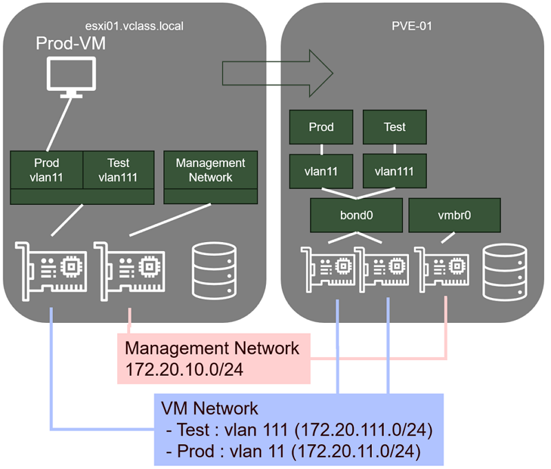

# Migration d'une machine virtuelle Windows en mode connecté

### Étape 1 - Préparation de la VM Prod-01:

Connectez-vous au ** Host-Client** de votre serveur ESXi-01, puis, successivement :

1. Connectez-vous en **console** votre VM **Prod-01** pour **désinstaller les VMware Tools** :
    Paramètres -> Applications -> VMware Tools -> Désinstaller -> Désinstaller puis, redémarrage
2. Arrêtez proprement Prod-01 (Depuis la console de la VM, car les VMware Tools ayant été désinstallés, il n’est plus possible de l’éteindre proprement depuis le Host-Client) :

### Étape 2 - Connexion du serveur Proxmox au serveur ESXi:

Connectez-vous à la **console d’administration** de votre serveur **PVE-01**, puis, successivement :

1. Dans l’arborescence, sélectionnez **Datacenter**, puis l’onglet **Storage**
2. Cliquez sur le bouton **Add** et choisissez **ESXi** dans le menu contextuel
3. Dans la fenêtre **Add ESXi**, complétez :

    - ID : esxStorage (Par exemple)
    - Server : esxi-01.vclass.local
    - Username : root
    - Password : Proxmox1!
    - Skip Certificate Verification : Oui  

    Cliquez sur le bouton **Add**  
    Vous voyez maintenant apparaitre votre serveur ESXi dans la liste de vos stockages  

### Étape 3 - Importation de la VM dans Proxmox

1. Dans l’arborescence, sélectionnez **esxStorage (pve-01)**
2. Sur l’écran principal, choisissez **…/Prod-01.vmx** et cliquez sur le bouton **Import**
3. Dans la fenêtre "Import Guest…", vérifiez les informations et corrigez si nécessaire :

    - Default Storage : **localVMs**
    - Default Bridge : **Prod**  
      Notez que les paramètres Sockets, Cores, Memory, Name, OS Type et Version correspondent aux caractéristiques de la VM sur esxi-01  
      Cliquez sur **Import**  

4. **Attendez** la fin de l’importation (10 minutes environ), puis **fermez** la fenêtre **Task Viewer**

### Étape 4 - Test, configuration et optimisation de la VM Windows (Prod-01)

1. Optimisation du Virtual Hardware

    - Dans l’interface d’administration de Proxmox, sélectionnez votre VM **Prod-01**
    - Cliquez sur l’onglet **Hardware**, puis modifiez les éléments matériels suivants :

      - Display : Graphic card : **SPICE**
      - SCSI Controller : **VirtIO SCSI single**
      - Network Device : Model : **VirtIO (paravirtualized)**
      - Supprimez le lecteur **CD/DVD (ide0)**
      - Ajoutez un lecteur **CD-DVD (sata1)** / (Do not use any media)

    - Cliquez sur l’onglet **Option**, puis modifiez les éléments suivants :

      - QEMU Guest Agent : Cocher la case **Use QEMU Guest Agent**

    - Démarrez la VM

2. Téléchargement des VirtIO Drivers pour Windows

    - Dans la barre de **favoris de votre Firefox**, dans le dossier **Tools**, sélectionnez "Windows VirtIO Drivers"
    -  Dans la page **Windows VirtIO Drivers**, trouvez et cliquez sur le lien **download the latest stable**
    - Le téléchargement de l’image ISO des VirtIO Drivers démarre
      Afin de vous faire gagner du temps, l’ISO a déjà été téléchargée. Vous pouvez donc **annuler le téléchargement** (Téléchargements\virtio-win-x.x.xxx.iso)
    - Utilisez **WinSCP** pour copier l’ISO dans le dossier **template/iso** du stockage **localLibrary**

3. Installation du QEMU guest-agent et des VirtIO Drivers

    - Dans l’interface d’administration de Proxmox, sélectionnez votre VM **Prod-01**
    - Cliquez sur l’onglet **Hardware**, sélectionnez **CD/DVD Drive**, puis cliquez sur le bouton **Edit**
    - Dans la fenêtre "Edit CD/DVD Drive", sélectionnez **Use CD/DVD disc …**

      - Storage : **localLibrary**
      - ISO Image : **virtio-win-x.x.xxx.iso**

    - Ouvrez une console **NoVNC** sur votre VM Prod-01
    - Depuis la console de la VM "Prod-01", lancez **d:\virtio-win-guest-tools.exe** (Si le lecteur CD n’apparait pas dans l’explorateur de fichiers Windows, redémarrez votre VM Prod-01)
    - Suivez la procédure d’installation :

      - "I agree to the license ….", Install
      - "Oui", "Next"
      - "I accept the terms …", "Next"
      - "Next", "Install"
      - "Finish"
      - "Close"

    - Si vous avez des difficultés à naviguer dans la VM avec la souris suite à l’installation des VirtIO Drivers, fermez la console NoVNC et ouvrez une nouvelle console SPICE.
    - Redémarrez proprement la VM "Prod-01"

4. Test de connectivité réseau :

    - Vérifiez que vous avez bien obtenu une adresse sur le réseau de prod (172.20.11.0/24) et que vous pouvez pinguer la passerelle (172.20.11.254)

5. Votre VM est maintenant fonctionnelle est optimisée pour Proxmox
6. N’oubliez pas de retirer le CD du lecteur de votre VM