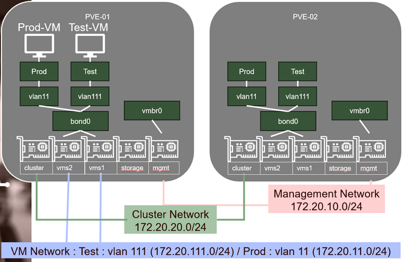

# Création d'un cluster Proxmox VE



### Étape 1 - Vérification des pre-requis

1. Ouvrez les **consoles** d’administration de vos **2 serveurs Proxmox** dans 2 onglets de Firefox
2. Vérification de la résolution DNS :  Ouvrez une console **shell** sur votre **premier serveur**
3. Vérifiez qu’il peut résoudre le nom du deuxième serveur :  
    ```nslookup pve-02.vclass.local```  
    La commande devrait vous retourner l’adresse du serveur (172.20.10.52)  
4. De la même façon, vérifiez que le deuxième serveur peut résoudre l’adresse du premier
5. Vérification de la synchronisation d’horloge  
    Vous pouvez utiliser la commande **date** pour vérifier que vos 2 serveurs sont synchronisés
6. Mettez à jour PVE-02

### Étape 2 - Création d’un réseau dédié au cluster

1. Depuis la **console** d’administration de **PVE-01**, dans la vue **Server View**, sélectionnez **pve-01**, puis, dans **System**, sélectionnez **Network**
2. Sélectionnez l’interface **nic_cluster**, puis cliquez sur le bouton **Edit**
3. Dans la fenêtre **Edit Network Device**, renseignez les champs suivants :
    - IPv4/CIDR : **172.20.20.51/24**
    - Autostart : **coché**
    - Comment : **Corosync**
    - N’oubliez pas d’**appliquer la configuration**
2. **Répétez** le point « a » sur le deuxième serveur (**PVE-02**)
    - IPv4/CIDR : **172.20.20.52/24**

### Étape 3 - Création du cluster sur PVE-01

1. Depuis la console d’administration de **PVE-01**, sélectionnez **Datacenter**, puis **Cluster**
2. Cliquer sur le bouton **Create Cluster**
3. Dans la fenêtre «Create Cluster», renseignez les champs suivants :
    - Cluster Name : My2nodesCluster
    - Cluster Network : Link 0 / 172.20.20.51
    Cliquez sur le bouton **Create**
4. Une fois la tâche terminée, fermez la fenêtre **Task Viewer**
5. Cliquez sur le bouton **Join Information**
6. Dans la fenêtre **Cluster Join Information**, cliquez sur le bouton **Copy Information** (Cela permet de copier dans le presse-papier le certificat permettant la jonction au cluster d’un nouveau serveur)
7. Fermez la fenêtre **Cluster Join Information**

### Étape 4 - Jonction au cluster de PVE-02

1. Depuis la console d’administration de **PVE-02**, sélectionnez **Datacenter**, puis **Cluster**
2. Cliquez sur le bouton **Join Cluster**
3. Dans la fenêtre **Cluster Join** :
    - Collez dans le champ texte le contenu du presse papier
    - Password : Proxmox1! (Mot de passe root de PVE-01)
    - Cluster Network : Link 0 / 172.20.20.52
    Cliquez sur le bouton **Join ‘My2nodesCluster’**
4. Retournez sur la console d’administration de PVE-01, lorsque vos 2 serveurs apparaissent en vert dans l’arborescence, votre cluster est créé
garde en double-cliquant sur la tâche **Backup Job** apparaissant en bas de l’écran. La sauvegarde dure environ 5 minutes. **Attendez la fin de la sauvegarde**. Il est important pour la suite des ateliers qu’elle s’exécute correctement