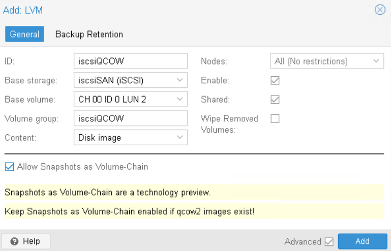

# Connexion au storage iSCSI

## Objectifs :

Dans cet exercice, vous allez :

- Objectif 1 - Connecter votre cluster Proxmox une cible iSCSI contenant des LUNs
- Objectif 2 - Exploiter le stockage iSCSI avec LVM
- Objectif 3 - Exploiter le stockage iSCSI avec LVM Volume-Chain

## Objectif 1 - Découverte et connexion à une cible iSCSI

### Étape 1 - Création du stockage iSCSI

1. Connectez-vous à l’interface d’administration du **Cluster 3 nœuds**. Firefox -> Scénario 3 -> PVE-03 (ou 04 ou 05)
2. Sélectionnez **Datacenter** -> **Storage** -> **Add** -> **iSCSI**
3. Dans la fenêtre "**Add iSCSI**", renseignez les paramètres suivants :

    | Paramètre | Valeur |
    | --- | --- |
    | ID | iscsiSAN |
    | Portal | 172.20.13.15 |
    | Target| Choisir iqn.2005-10.org.freenas.ctl:iscsi-target |
    | Nodes | All |
    | Enable | Oui |
    | Use LUNs | Oui |

4. Validez la création du stockage en cliquant sur **Add**
    

### Étape 2 - Vérification de la connexion

1. Dans l’inventaire, sélectionnez le stockage **iscsiSAN**.
2. Consultez l'onglet **Status**.  
    Vous constatez que 3 LUNs sont maintenant visibles : LUN1, LUN2 et LUN3
3. Ouvrez une session **Shell** sur un **autre noeud** de votre cluster et exécutez la commande :```iscsiadm -m session```  
    Vous constatez qu'une session a bien été établie vers la cible iqn.2005-10.org.freenas.ctl:iscsi-target
5. Exécutez ensuite ```lsblk```  
    Vous pouvez maintenant identifier les nouveaux périphériques correspondant aux LUNs exposés par le serveur de stockage (sdb, sdc et sdd)
7. Vous pouvez fermer la fenêtre de la session Shell.
8. Dans l'interface d'administration, dans l'inventaire, vérifiez que **iscsiSAN** est visible sous chaque noeud de votre cluster.  
    En effet, le stockage iSCSI est un stockage partagé accessible simultanément par tous les noeuds du cluster

## Objectif 2 - Exploitation du stockage iSCSI avec LVM

### Étape 1 - Création du stockage LVM

1. Connectez-vous à l’interface d’administration du **Cluster 3 nœuds**. Firefox -> Scénario 3 -> PVE-03 (ou 04 ou 05)
2. Sélectionnez **Datacenter** -> **Storage** -> **Add** -> **LVM**
3. Dans la fenêtre "**Add LVM**", renseignez les paramètres suivants :

    | Paramètre | Valeur |
    | --- | --- |
    | ID | iscsiLVM |
    | Base Storage | iscsiSAN |
    | LUN | LUN 1 |
    | Volume Group | iscsiLVM |
    | Content | Disk image |
    | Shared | Oui |

4. Validez la création du stockage en cliquant sur **Add**  
    

### Étape 2 - Vérification du stockage

1. Dans l’inventaire, vérifiez que **iscsiLVM** apparait également sur vos 2 autres noeuds (pve-04 et pve-05)
2. Si le stockage apparait avec un '?', il faut forcer un rescan depuis une session Shell sur chaque noeud :  
    ```
    pvscan --cache
    ```

### Étape 3 - Déplacement de la machine virtuelle

1. Sélectionnez la machine virtuelle **Test-01**.  
2. Ouvrez l'onglet **Hardware**.
3. Sélectionnez le disque principal de la machine virtuelle.
4. Cliquez sur **Disk Action** puis **Move Storage**.

    | Paramètre | Valeur |
    | --- | --- |
    | ID | iscsiLVM |
    | Target Storage | iscsiLVM |
    | Delete source | Oui |

5. Cliquez sur **Move Storage** et attendez la fin de l'opération.  
    Le disque virtuel de Test-01 est maintenant hébergé sur notre stockage iSCSI

### Étape 4 - Limitations du LVM

1. Sélectionnez la machine virtuelle **Test-01**.  
2. Ouvrez l'onglet **Snapshots**.  
    Vous constatez ici que le bouton Snapshot est grisé  
    En effet, le stockage LVM partagé sur iSCSI utilise des volumes logiques RAW. Ce type de stockage ne prend pas en charge les snapshots de disques virtuels utilisés par Proxmox. Les fonctionnalités de snapshot nécessitent un mécanisme de type copy-on-write, disponible sur d'autres stockages comme QCOW2, ZFS ou Ceph RDB.  
    Le stockage iSCSI/LVM classique privilégie la simplicité et les performances, au détriment des fonctionnalités avancées de gestion des snapshots
    
## Objectif 3 - Exploitation du stockage iSCSI avec Volume Chain

### Étape 1 - Création du stockage LVM avec Volume Chain

1. Connectez-vous à l’interface d’administration du **Cluster 3 nœuds**. Firefox -> Scénario 3 -> PVE-03 (ou 04 ou 05)
2. Sélectionnez **Datacenter** -> **Storage** -> **Add** -> **LVM**
3. Dans la fenêtre "**Add LVM**", renseignez les paramètres suivants :

    | Paramètre | Valeur |
    | --- | --- |
    | ID | iscsiQCOW |
    | Base Storage | iscsiSAN |
    | LUN | LUN 2 |
    | Volume Group | iscsiQCOW |
    | Content | Disk image |
    | Shared | Oui |
    | Allow Snapshots as Volume-Chain | Oui |

4. Validez la création du stockage en cliquant sur **Add**  
    

### Étape 2 - Vérification du stockage

1. Dans l’inventaire, vérifiez que **iscsiQCOW** apparait également sur vos 2 autres noeuds (pve-04 et pve-05)
2. Si le stockage apparait avec un '?', il faut forcer un rescan depuis une session Shell sur chaque noeud :  
    ```
    pvscan --cache
    ```

### Étape 3 - Déplacement de la machine virtuelle

1. Sélectionnez la machine virtuelle **Test-01**.  
2. Ouvrez l'onglet **Hardware**.
3. Sélectionnez le disque principal de la machine virtuelle.
4. Cliquez sur **Disk Action** puis **Move Storage**.

    | Paramètre | Valeur |
    | --- | --- |
    | ID | iscsiLVM |
    | Target Storage | iscsiQCOW |
    | Format | QEMU image format (qcow2) |
    | Delete source | Oui |

5. Cliquez sur **Move Storage** et attendez la fin de l'opération.  
    Le disque virtuel de Test-01 est maintenant hébergé sur notre stockage iSCSI