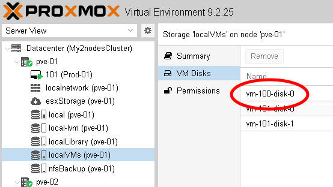

# Live Migration / Réplication des machines virtuelles

## Objectifs

Dans cet exercice, vous allez :

- Objectif 1 - Déplacer le disque d'une VM entre 2 stockages
- Objectif 2 - Convertir le disque d'une VM
- Objectif 3 - Déplacer une VM entre 2 serveurs Proxmox (Live Migration avec stockage local)
- Objectif 4 - Mettre en place la réplication de VMs
- Objectif 5 - Déplacer une VM entre 2 serveurs Proxmox (Live Migration avec stockage répliqué)

## Étapes préalable

### Préparation des tests de migration
Nos tests de migration vont être réalisés sur la VM Test-01.  
Nous souhaitons vérifier la connectivité de cette machine à chaque étape des tests.  
Pour cela :  

1. Ouvrez une console sur Test-01
2. Depuis la console de Test-01, exécutez la commande :
    ```ping 172.20.111.254```
3. Laissez le ping s’effectuer en boucle, vous y reviendrez à chaque étape pour vérifier si vous avez eu des pertes de paquets

### Configuration d’un 2ème stockage local de type « Disk Image » sur PVE-01 :
Afin de tester le déplacement de VMs entre 2 stockages du même serveur (storage Live Migration), nous avons besoin d’un 2ème stockage autorisant le type "Disk Image" (local-lvm ne dispose pas de suffisamment d’espace disponible). Nous allons donc **autoriser** temporairement les données de type **Disk Image** sur notre stockage **localLibrary** de type **Directory**. **Faites le nécessaire** (Si vous ne vous souvenez plus comment faire, vous pouvez vous aider de l’Exercice 5 de l'atelier 1 - Configuration du stockage local

### Déclaration de localVMs sur PVE-02 en tant que ressource cluster :
localVMs, le stockage ZFS pour héberger les Disk Images, existe bien sur PVE-02. Vous pouvez le vérifier en allant sur **pve-02 -> Disks -> ZFS**
Mais comme il a été créé avant que PVE-02 soit intégré au cluster, il n’apparait pas dans les ressources du datacenter. Autrement dit, le stockage localVMs n’est pas vu par le Datacenter comme une ressource disponible sur PVE-02.
**Faites le nécessaire**

## Objectif 1 - Déplacement du disque de Test-01 vers le stockage localLibrary

1. Depuis la console d’administration de PVE-01, dans l’arborescence, sélectionnez votre VM Test-01, puis sélectionnez « Hardware »
2. Sélectionnez ensuite le disque de votre VM, et dans « Disk Action », choisissez « Move Storage »
3. Dans la fenêtre « Move disk », choisissez :

    - Target Storage : **localLibrary**
    - Format : **Raw disk**
    - Delete source : **Oui**
    
    Cliquez sur **Move Disk**

4. Une fenêtre de tâche s’ouvre où vous pouvez suivre la migration
5. Une fois la migration terminée, **fermez la fenêtre de tâche**
6. Notez la **durée** de la tâche (End Time – Start Time en bas de l’écran)
7. **Vérifiez** si vous avez perdu des paquets

## Objectif 2 - Conversion de disque virtuel

1. Vous vous rendez compte que depuis que vous avez changé votre VM de stockage, il n’est plus possible de la snapshoter :  
    Test-01 -> Snapshot -> Le bouton "Take Snapshot" est grisé  
    En effet, lors de la conversion, vous avez choisi le format **Raw Disk** qui ne permet pas de faire des snapshots sur un stockage **File**.  
2. Vous décidez alors de convertir de disque virtuel en **Qcow2** :  
    Test-01 -> Hardware -> Hard Disk (scsi0) -> Disk Action -> Move Storage

    - Target Storage : **localLibrary** (Oui, le disque virtuel est déjà sur ce stockage)
    - Format : **QEMU image format**
    - Delete source : **Oui**

    Proxmox va interpréter cette demande et convertir sur place votre disque virtuel

3. **Vérifiez** que le bouton **Take Snapshot** est à nouveau accessible
4. En utilisant la fonction **Move Storage** vue précédemment, replacez le disque de Test-01 sur localVMs
5. **Supprimez** le type **Disk Image** du stockage **localLibrary**

## Objectif 3 - Déplacement d'une VM entre 2 serveurs Proxmox (Live Migration avec stockage local)

1. Faites un clic-droit sur **Test-01**, choisissez **Migrate**
2. Dans la fenêtre **Migrate**, choisissez :

    - Target node : **PVE-02**
    - Target storage : **current layout**  
      En choisissant cette option, vous demandez à Proxmox de migrer la VM vers le stockage de PVE-02 portant le même nom que le stockage actuel (localVMs)

    Cliquez sur « Migrate »

3. Une fois la migration terminée :
    - Notez la durée de la tâche
    - Vérifiez si vous avez perdu des paquets  
      Il est normal que le changement de serveur ait figé la console de votre VM (C’est bien la console qui est figée, pas la VM)  
      N’hésitez pas à fermer cette console et à en ouvrir une nouvelle

## Objectif 4 - Mise en place de la réplication  

Notre VM Test-01 est maintenant sur le PVE-02, et sur le stockage localVMs de type ZFS. Ce type de stockage supporte la réplication

1. Depuis la console d’administration de Proxmox, sélectionnez votre VM **Test-01**, **Replication**, puis cliquez sur le bouton **Add**  
    Dans la fenêtre **Create Replication Job**, choisissez :

    - Target : **pve-01**
    - Schedule : Laissez la valeur par défaut (Toutes les 15 minutes)
    - Rate limit : **unlimited**
    - Enabled : **Oui**

    Cliquez sur le bouton **Create**

2. Le Job de réplication apparait maintenant dans la liste  
    Son status est **Ok**  
    Attendez que le champ **Last Sync** affiche quelque chose (cela indique qu’au moins une réplication a eu lieu)
3. Une fois la réplication terminée :

    - Notez la durée de la tâche
    - Vérifiez si vous avez perdu des paquets

4. Vous pouvez vérifier la présence du fichier de disque virtuel de Test-01 sur le stockage localVMs de PVE-01 en le sélectionnant dans l’arborescence :


## Objectif 4 - Déplacement d'une VM entre 2 serveurs Proxmox (Live Migration avec stockage répliqué)

1. Faites un clic-droit sur Test-01, choisissez **Migrate**
2. Dans la fenêtre **Migrate**, choisissez :

    - Target node : **PVE-01**
    - Target storage : **current layout**

    Cliquez sur **Migrate**

3. Dans les premières lignes du log, vous verrez la ligne :  
    ```found local, replicated disk 'localVMs:vm-101-disk-0' (attached)```  
    Cela indique que proxmox a bien détecté que le disque était présent sur la destination et qu’il ne fera qu’une réplication, et non un déplacement complet

4. Une fois la migration terminée :

    - Vérifiez si vous avez perdu des paquets
    - Notez la durée de la tâche  
      
    > Vous devriez constater que la migration a duré beaucoup moins longtemps que celles qui avaient été effectuées avant la mise en place de la réplication