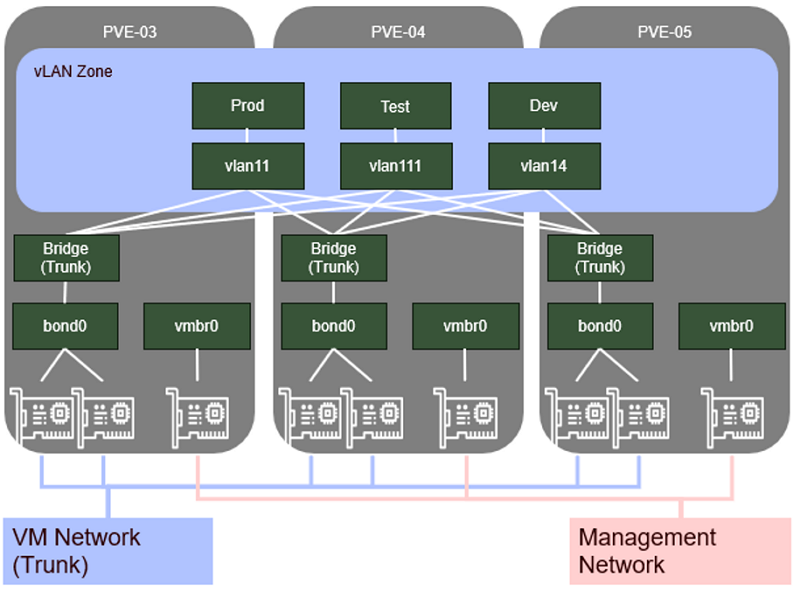

# Configuration centralisée des vLans

## Objectifs

Un nouveau cluster à 3 nœuds a déjà été mis en place.  
Les réseaux de Management et de réplication ont déjà été configurés.  
En revanche, côté VMs, rien n’a été fait  

Dans ce lab, vous êtes chargé de :

- Objectif 1 - Créer un bond et un bridge "VLAN Aware" sur chacun des serveurs
- Objectif 2 - Créer une Zone de type vLAN
- Objectif 3 - Créer 2 vNets (pour la Prod et le Test) dans cette zone



## Etapes préalables

1. **Connectez-vous** à l’interface d’administration du nouveau Cluster  
    Firefox -> Scénario 3 -> PVE-03 (ou 04 ou 05)
2. **Mettez** à jour les 3 nœuds

## Objectif 1 - Création des Bonds et des Bridges

1. Dans l’arborescence, sélectionnez le premier de vos 3 serveurs Proxmox, puis sélectionnez l’onglet **Network**
2. Cliquez sur le bouton **Create**, puis choisissez **Linux Bond**
3. Renseignez les champs suivants :

    - Name : ```bond0```
    - Slaves : ```nic_vms1 nic_vms2```
    - Bond-primary : ```nic_vms1```
    - Mode : **active-backup**
    - Comment : ```VMs```

    Cliquez sur le bouton **Create**

4. Cliquez sur le bouton **Create**, puis choisissez **Linux Bridge**
5. Renseignez les champs suivants :

    - Name : ```VMs```
    - Bridge ports : ```bond0```
    - Comment : ```VMs```

    Cliquez sur le bouton **Create**

6. Cliquez sur le bouton **Apply Configuration**, puis **Yes**
7. Répétez ces étapes pour les 2 autres serveurs Proxmox

## Objectif 2 - Création d’une zone de type **vLAN**

1. Dans l’arborescence, sélectionnez **Datacenter*, puis, dans **SDN**, choisissez **Zones**
2. Cliquez sur le bouton **Add** et choissez **VLAN**
3. Dans la fenêtre **Add VLAN**, renseignez les champs suivants :

    - ID : ```VMs```
    - Bridge : ```VMs```

Cliquez sur le bouton **Add**

4. Pour appliquer vos modifications, sélectionnez l’onglet **SDN**, et cliquez sur le bouton **Apply**

## Objectif 3 - Création des vNets

1. Sélectionnez l’onglet **VNets**, puis cliquez sur le bouton **Create**
2. Dans la fenêtre **Create VNet**, renseignez les champs suivants :

    - Name : ```Prod```
    - Zone : **VMs**
    - Tag : ```11```

Cliquez sur le bouton **Create**

3. Répétez l’opération pour créer un VNet **Test** :

    - Name : **Test**
    - Zone : **VMs**
    - Tag : **111**

4. N’oubliez pas d’appliquer vos modifications  
    Vous pouvez maintenant constater que chacun de vos 3 serveurs disposent de la zone VMs ainsi que de ses 2 VNets