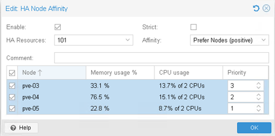
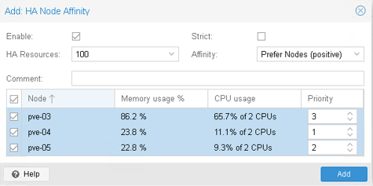

# Mise en place de la haute disponibilité

## Objectifs

Dans cet exercice, vous allez :

- Objectif 1 - Mettre en place la protection des VMs
- Objectif 2 - Mettre en place des règles d'affinité
- Objectif 3 - Configuration la Shutdown Policy

## Etapes préalables

Dans ce Lab, nous allons être amenés à arrêter certains de nos serveurs Proxmox. Il faudra donc être capable de les "rallumer". Pour cela :

1. Dans la barre de favoris de **Firefox**, dans le dossier **Scénario 3**, choisissez **PVE Servers Consoles**
2. Dans la fenêtre de Login **VMware vSphere**, authentifiez-vous avec vos identifiants Guacamole (en ajoutant **mars\** avant votre nom d’utilisateur
3. Dans la vue **VMs & Templates**, naviguez jusqu’au dossier où se situent toutes vos VMs utilisées pendant votre formation dont vos serveurs Proxmox (pve-03, pve-04, pve-05)
4. Lorsqu’il sera question dans le lab de "rallumer" ces VMs, c’est ici que ça se passe, donc laissez cet onglet ouvert dans Firefox

Ensuite :

1. **Connectez-vous** à l’interface d’administration de votre **clusteur 3 noeuds**
    Firefox -> Scénario 3 -> PVE-03 (ou 04 ou 05)
2. Vérifiez que vos 2 VMs sont hébergées par le serveur **PVE-03**. Si ce n’est pas le cas, migrez-les vers PVE-03

## Objectif 1 - Mise en place de la protection des VMs

1. Dans l’arborescence, sélectionnez **Datacenter**, puis **HA**
2. Dans la zone **Status**, vous constatez que :

    - Le quorum est OK
    - L’un de vos serveurs est Master
    - Les autres sont fonctionnels mais non utilisés (idle)

    > Il est possible que ces 2 dernières informations ne s’affichent pas avant l’activation de la protection des VMs. Si c’est le cas, vous retrouverez ces informations un peu plus tard
	
3. La zone Resources est vide. Aucune de vos VMs n’est protégée
4. Ajoutez votre VM de Prod :

    - Cliquez sur le bouton **Add** pour ajouter une VM
    - Dans la liste, choisissez **Prod-01**
    - Cliquez sur le bouton **Add**
    - Votre VM Prod-01 est maintenant protégée

    > Dans la zone **Status**, son Host est passé de **idle** à **Active**

5. Si votre console d’administration est ouverte sur **PVE-03**, ouvrez-en une nouvelle sur **PVE-05**
6. Dans cette nouvelle console, dans l’arborescence, sélectionnez le serveur **PVE-03** et cliquez sur le bouton **Shutdown** (en haut à droite de votre console), puis validez en cliquant sur le bouton **Yes**
7. Sélectionnez **Datacenter**, puis **HA** afin de pouvoir contrôler le **statut** des serveurs et des VMs
8. Dans la zone **Status**, vous allez voir votre serveur **PVE-03** passer successivement :

    - De **Active**
    - A **Shutdown mode**
    - Puis **old timstamp – dead ?**

9. Votre VM Prod-01 va alors redémarrer sur un autre serveur de votre cluster, tandis-que la VM Test-01 restera arrêtée (Elle n’est pas protégée)
10. **Attendez** que Prod-01 soit redémarrée
11. **Rallumez** votre serveur **PVE-03** et attendez qu’il soit à nouveau en ligne
12. **Démarrez Test-01**
13. Ajoutez **Test-01** dans les liste des ressources protégées par HA

## Objectif 2 - Création de règles d'affinitié

1. Nous allons maintenant créer des règles d’affinité afin de répartir nos VMs.   
    Sélectionnez **Datacenter**, puis, dans **HA**, sélectionnez **Affinity Rules**  
    Nous souhaitons répartir les VMs de la façon suivante (Objectifs) :  

    | ID de groupe | Priorité pve-03 | Priorité pve-04 | Priorité pve-05 |
    | --- | --- | --- | --- |
    | Prod | 3 | 2 | 1 |
    | Test | 3 | 1 | 2 |

    Dans ce scénario, nous souhaitons qu’en temps normal, toutes les VMs soient exécutées sur PVE-03 (Parce qu’il a des processeurs à plus haute fréquence par exemple). En revanche, en cas de panne de ce serveur, nous souhaitons que les VMs de Prod soient redémarrées sur PVE-04, et que les VMs de Test soient redémarrées sur PVE-05. (Ce scénario n’est en rien une recommandation d’architecture et n’est fourni ici qu’à titre d’exemple)

2. Ajout d’une règle pour Prod-01

    - Dans la zone **HA Node Affinity Rules**, cliquez sur **Add**
    - Dans le champ **HA Resources**, sélectionnez **Prod-01**
    - Dans le tableau, sélectionnez vos 3 serveurs et définissez les priorités conformément aux objectifs
      
    - Cliquez sur **Add** (ou **Ok**)

3. Ajout d’une règle pour Test-01

    - Faites de même pour Test-01
      
    - Cliquez sur **Add** (ou **Ok**)

> Vous pouvez constater que très rapidement, Prod-01 est migrée automatiquement sur pve-03

4. Test de HA

    - Arrêtez **PVE-03** afin de vérifier le redémarrage des 2 VMs sur leur serveur respectif
    - Une fois le test validé, **rallumez PVE-03**
    - Attendez que les VMs aient repris leur place sur PVE-03

## Objectif 3 - Configuration de la Shutdown Policy
Maintenant, nous souhaiterions qu’en cas d’arrêt ou de redémarrage volontaire d’un serveur, les VMs soient déplacées à chaud plutôt que d’être (mal) arrêtées.  
Pour cela, nous allons modifier la **Shutdown_Policy** du datacenter

1. Dans **Datacenter**, sélectionnez **Options**, puis **HA Settings**
2. Cliquez sur le bouton **Edit**
3. Dans la fenêtre **Edit HA Settings**, choisissez la shutdown policy **Migrate**
4. Faites un **Shutdown** de **PVE-03**  
    Dans Datacenter -> HA, vous verrez PVE-03 passer en **Maintenance Mode**
    Vous pourrez constater que vos 2 VMs sont tout d’abord déplacées vers leur serveur respectif avant que le serveur ne soit arrêté
5. **Rallumez PVE-03**